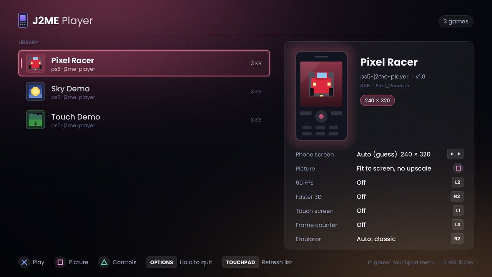
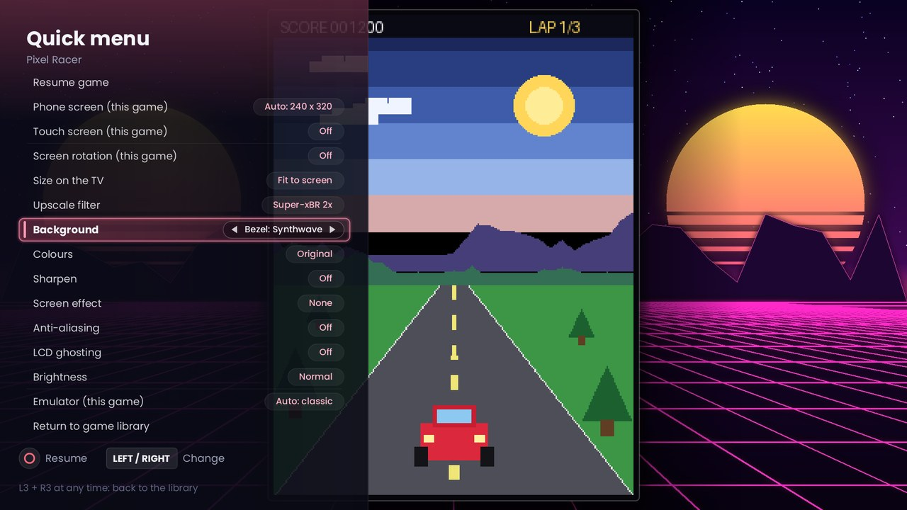
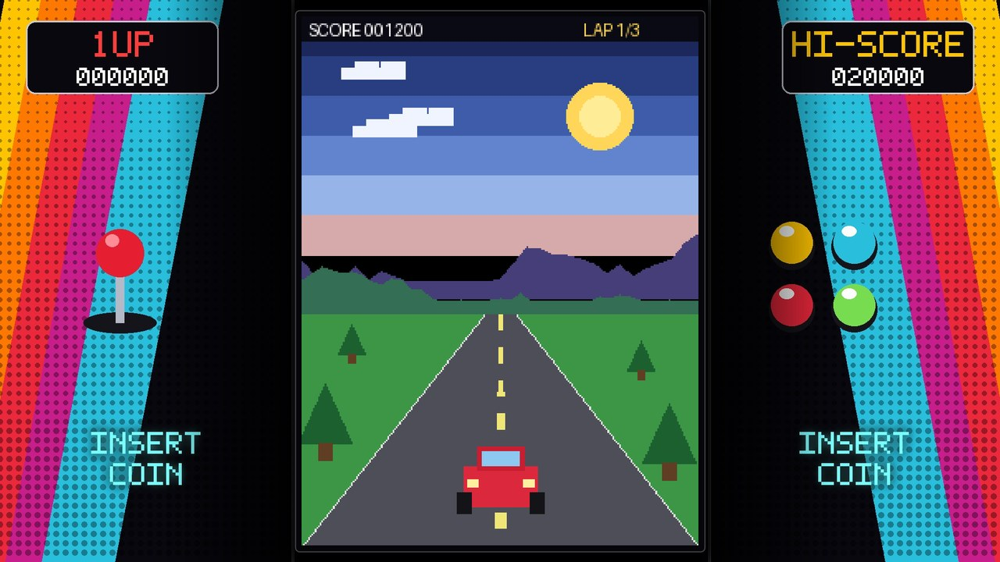
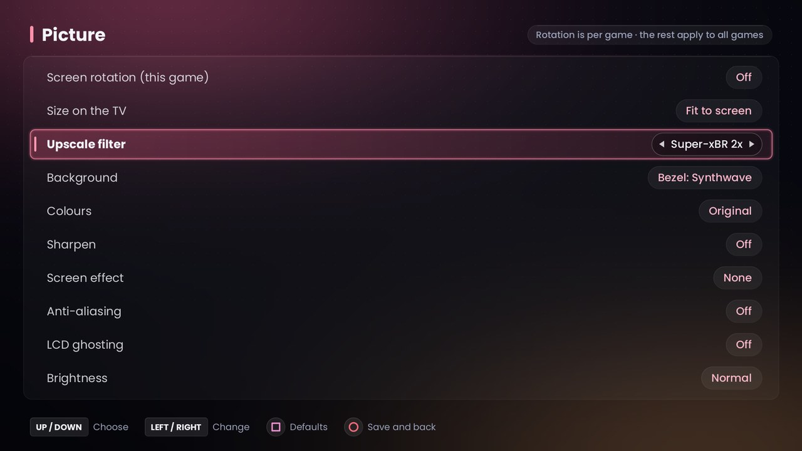
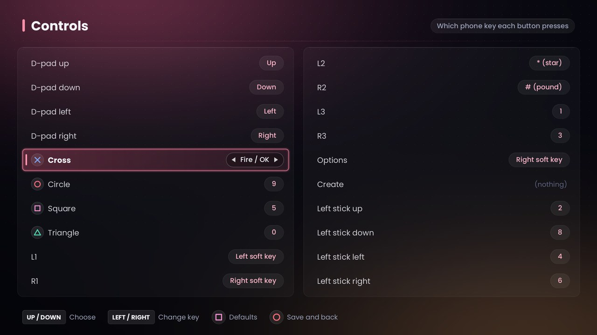
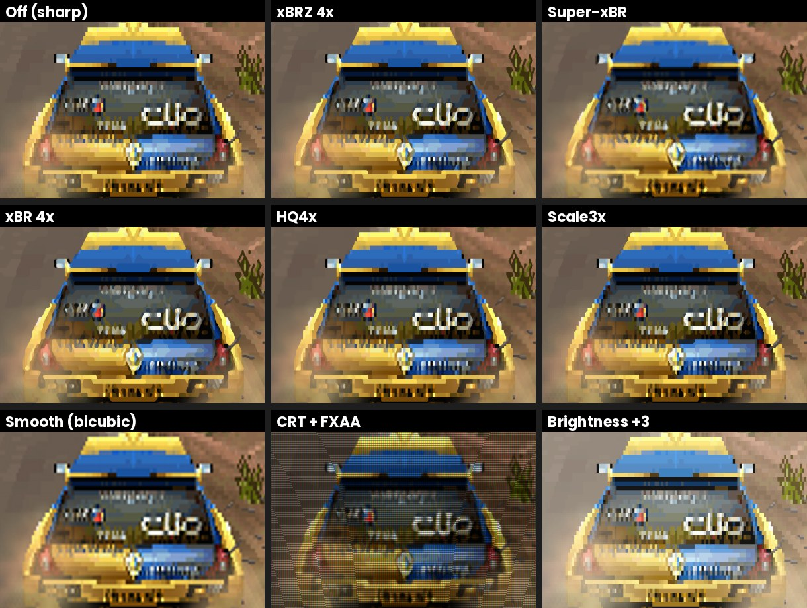

# J2ME Player for PS5

A native Java ME (J2ME) phone-game player for jailbroken PlayStation 5 consoles.
It runs the [FreeJ2ME-Plus](https://github.com/TASEmulators/freej2me-plus) emulator
on a Java virtual machine built for the PS5, with a console-style game library,
controller support, picture upscalers and arcade bezels. It installs as an app on
the PS5 home screen.



> **Version 1.0.** Tested on firmware 6.02. 2D games run at full speed. 3D games
> work but are slow in busy scenes, because the Java on the PS5 has no JIT
> compiler yet (see [Known limitations](#known-limitations)).

## Features

**Library**
- Home-screen app ("J2ME Player") with a modern 1080p interface and smooth fades between screens.
- Game library with icons, names, makers and versions read from each game.
- Each game gets its own colour theme, taken from its icon.
- Games are added over FTP into `/data/jvm/games`. Tap the **touchpad** in the library to refresh the list; it also refreshes itself when you leave a game.
- **Delete games** from the library: hold the touchpad, then choose to delete the game alone or the game and its saves.
- **Leave a game and go straight back to the library** without the app restarting: L3 + R3, the quick menu, or the game's own Exit.

**Screen size**
- Automatic phone screen size. Each game is checked from its files when it starts, and from how it draws while it runs. A wrong size is corrected on the fly, with no restart.
- 25 phone screen sizes from 128×128 to 1920×1080 to choose from, saved per game. You can also change the size during a game.
- Screen rotation per game, for games made to be played with the phone held sideways.

**Controls**
- Fully remappable controller: every DualSense button and the left stick can press any phone key.
- **Touch-screen games**: the right stick moves a smooth pointer and R2 touches (press, drag, release). It turns on automatically for games marked as touch games.

**Picture**
- **Upscalers**: xBRZ (2–6×), Super-xBR, xBR (2–4×), HQx (2–4×), Scale2x/3x, and smooth bicubic for 3D games.
- **Anti-aliasing (FXAA)** for jagged 3D edges, **sharpening**, **brightness** and **colour** modes (vivid, warm).
- **Screen effects**: scanlines, LCD grid, a curved CRT look, and LCD ghosting (the motion blur of old phone screens).
- **Backgrounds**: black, an ambient glow made from the game's own colours, or arcade bezel artwork (Synthwave, Arcade).
- Fit, stretch and pixel-perfect sizing.

**In-game quick menu** (touchpad)
- Change any picture setting, the screen size, rotation, touch or emulator while you play.
- Changes show straight away on the paused game.

**Speed and compatibility**
- Optional 60 FPS mode and faster half-resolution 3D, per game.
- Two FreeJ2ME-Plus builds included. 3D games automatically use the newer one, which draws some 3D games (such as racing tracks) correctly. 2D games use the stable v1.52. You can override this per game. Going from a 2D game to a 3D game swaps the emulator build inside the running app, with no restart.
- Sound and music: sampled sound plus MIDI, played through the PS5's own audio output.
- Fast game start: the music synthesizer is prepared in the background while you browse.

| | |
|---|---|
|  |  |
|  |  |

Upscalers, close up:



## Installing

You need a jailbroken PS5 with an **ELF loader on port 9021** (for example
[ps5-payload-elfldr](https://github.com/ps5-payload-dev/elfldr)) and an **FTP server**
(the release was tested with one on port 2121). The commands below use `socat`
on a Linux PC; replace `PS5_IP` with your console's address.

1. **Java runtime (once).** Download `ps5j2me-java-runtime-1.0.zip` from the
   [release](../../releases/latest), unzip it, and upload the `jvm` folder to
   `/data/jvm` on the console over FTP. When you're done, `/data/jvm/lib/modules` should exist.
2. **The app.** Send the installer:
   ```
   socat -t 60 - TCP:PS5_IP:9021 < ps5j2me-install-1.0.elf
   ```
   It writes the app to `/data/homebrew/PS5J2ME` and adds the **J2ME Player** tile to the home screen.
3. **Games.** Copy `.jar` (or `.jad`) files to `/data/jvm/games` over FTP.
4. **Start** from the home-screen tile, or from a PC:
   ```
   socat -t 30 - TCP:PS5_IP:9021 < ps5j2me-launch.elf
   ```

Settings are kept in `/data/jvm/fj/ps5-settings.properties`. The log of the last
run is in `/data/jvm/ps5j2me.log`; attach it when you report a problem.

## Controls

| In the library | |
|---|---|
| Up / Down | Choose a game |
| Left / Right | Phone screen size (Auto or a fixed size) |
| ✕ | Play |
| □ | Picture settings |
| △ | Controller settings |
| L1 / L2 / L3 / R3 | Touch screen / 60 FPS / frame counter / faster 3D |
| R1 / R2 | Cycle upscaler / emulator build |
| Touchpad (tap) | Refresh the game list |
| Touchpad (hold) | Delete the highlighted game |
| Hold OPTIONS | Quit to the PS5 home screen |

| In a game | |
|---|---|
| D-pad, ✕, ○, □, △, L1, R1… | Phone keys (remap them in Controller settings) |
| Touchpad | Quick menu |
| L3 + R3 | Back to the library |
| Right stick + R2 | Touch pointer (touch games) |
| Hold OPTIONS | Quit |

## Known limitations

- **3D speed.** The Java VM is OpenJDK's interpreter-only "Zero" build. Heavy 3D races can drop to around 10 FPS. "Faster 3D" (half resolution) helps; a JIT build would be the real fix.
- **Emulator switching memory.** Switching between the two emulator builds happens inside the app. If old copies of a build can't be freed from memory, the app falls back to restarting itself for the next switch; the log says when this happens.
- Some games were sold in versions for specific phones and expect that phone's screen size. If automatic sizing guesses wrong, pick the size by hand.
- Only one controller is used.

## Building

See [BUILDING.md](BUILDING.md). In short:
1. Build OpenJDK 21 (Zero) for the PS5 with the scripts in [`jdk-port/`](jdk-port).
2. Build the PS5 SDL2 port.
3. Run `./build-app.sh`, which compiles the app, patches the emulator and packs the installer.

## Credits

This player stands on a lot of other people's work. Thank you:

- **[FreeJ2ME-Plus](https://github.com/TASEmulators/freej2me-plus)** (GPLv3): the J2ME emulator itself, by the TASEmulators contributors, building on the original **FreeJ2ME** by David Richardson and the [Recompile](https://github.com/hex007/freej2me) team. Both the v1.52 release and a newer build (commit `baca76a`) are included unmodified; small compatibility patches are applied at build time (see `java/PatchCanvas.java`).
- **[OpenJDK](https://openjdk.org/)** 21 (GPLv2 with Classpath Exception), via the FreeBSD port **[battleblow/jdk21u](https://github.com/battleblow/jdk21u)**, cross-built for the PS5.
- **[ps5-payload-dev](https://github.com/ps5-payload-dev)** by John Törnblom: the PS5 payload SDK, the SDL2 port, and the homebrew loader code used by the launcher (`launcher/vendor`, GPLv3).
- **[xBRZ](https://sourceforge.net/projects/xbrz/)** by Zenju (GPLv3).
- **Super-xBR** and **xBR** by Hyllian. The xBR, **HQx** (Maxim Stepin, Cameron Zemek, LGPL 2.1) and **ScaleNx** code comes from [gimp-plugin-pixel-art-scalers](https://github.com/ImageProcessing-ElectronicPublications/gimp-plugin-pixel-art-scalers) (GPLv3); the Super-xBR C version in `app/superxbr.c` was written for this project from Hyllian's algorithm.
- **[libffi](https://sourceware.org/libffi/)** (MIT) and **[ObjectWeb ASM](https://asm.ow2.io/)** (BSD, bundled with FreeJ2ME-Plus).
- Fonts: **[Poppins](https://fonts.google.com/specimen/Poppins)** by Indian Type Foundry (SIL OFL 1.1) and **[DejaVu](https://dejavu-fonts.github.io/)** (free licence).

J2ME, Java and PlayStation are trademarks of their respective owners. This
project isn't affiliated with Sony, Oracle or any game publisher. No games
are included; use games you own.

## Licence

J2ME Player for PS5 is free software, licensed under the **GNU General Public
License v3.0**; see [LICENSE](LICENSE). Bundled third-party parts keep their own
licences, listed in [CREDITS.md](CREDITS.md).
